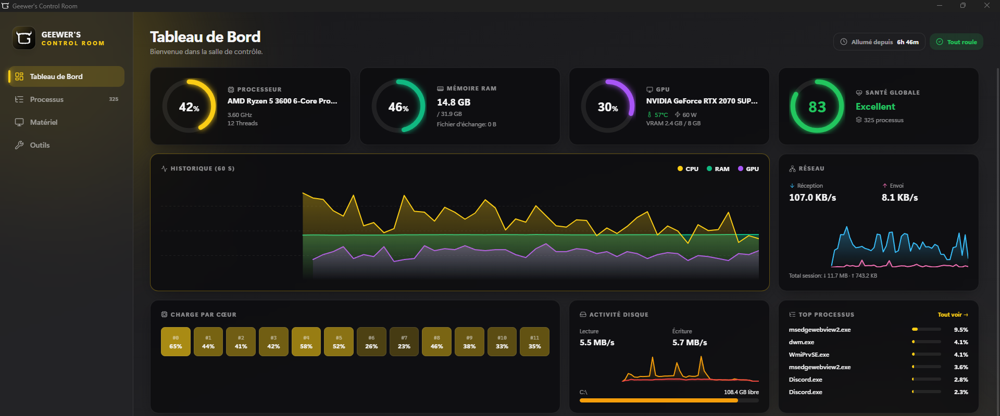

# Geewer's Control Room 1.1.0


Salut ! **Geewer's Control Room**, c'est ta station de contrôle ultime pour garder un œil sur ton PC.

J'en avais marre du Gestionnaire des tâches moche ou des logiciels usine à gaz pour voir si mon PC chauffait. J'ai créé cette app pour avoir un dashboard stylé, fluide et précis. Elle surveille tes composants, teste tes performances et te donne les infos essentielles en un clin d'œil.

C'est léger, ça ne bouffe pas tes FPS, et c'est codé avec **Tauri (Rust)** pour une rapidité maximale.



---

## 🇫🇷 Fonctionnalités

* **Tableau de Bord Temps Réel** : jauges CPU / RAM / GPU, historique sur 60 s, charge par cœur, débit réseau et activité disque à la seconde.
* **GPU en direct** (NVIDIA) : charge, température, VRAM, consommation et ventilateur.
* **Santé du PC** : note sur 100 + alertes visuelles quand le CPU, la RAM ou la température GPU dépassent tes seuils.
* **Gestionnaire de Processus** : top 60 des processus, recherche, tri, et bouton « Terminer » avec confirmation.
* **Matériel détaillé** : CPU, vraie carte graphique (ignore les adaptateurs virtuels), barrettes RAM, carte mère, BIOS, disques et périphériques. Copie du rapport complet en un clic.
* **Outils** :
    * 🧪 **Benchmark CPU** mono et multi-cœur, avec historique et record.
    * 🌐 **Test Réseau** vers Google, Cloudflare et Quad9 : latence, gigue et pertes.
* **Barre des tâches** : icône avec CPU/RAM au survol, option pour réduire l'app au lieu de la fermer.
* **C'est ton interface** : 12 thèmes + personnalisation complète des couleurs, FR/EN, raccourcis clavier (1-4, Échap).

---

## 🛠️ Comment l'installer ou le tester ?

Si tu veux tester le projet ou modifier le code, c'est assez simple. Il te faut juste **Node.js** et **Rust** installés sur ta machine.

1.  **Récupère le projet**
    ```bash
    git clone [https://github.com/BateMane/geewerscontrolroom.git](https://github.com/BateMane/geewerscontrolroom.git)
    cd geewer-hw-monitor
    ```

2.  **Installe ce qu'il faut**
    ```bash
    npm install
    ```

3.  **Lance l'app**
    ```bash
    npm run tauri dev
    ```

Et voilà, la salle de contrôle est ouverte !

---

## 💻 C'est fait comment ?

Pour les curieux, voici la stack technique :
* **Frontend** : Svelte + Tailwind CSS (pour le design Cyberpunk fluide).
* **Backend** : Rust via Tauri (pour les performances et l'accès bas niveau au matériel via `sysinfo` et `PowerShell`).

Si tu as des idées pour améliorer le tool ou si tu trouves un bug, n'hésite pas à ouvrir une *Issue* ou à utiliser le bouton de feedback directement dans les paramètres de l'app !

---

<br>

# 🇬🇧 English Description

**Geewer's Control Room** is your ultimate dashboard to monitor your PC stats with style.

Tired of the ugly Task Manager? This app provides a sleek, Cyberpunk-inspired interface to monitor your hardware in real-time without eating up your resources.

### ⚡ What can it do?

* **Real-time Dashboard:** CPU / RAM / GPU gauges, 60 s history, per-core load, network and disk throughput.
* **Live GPU stats** (NVIDIA): load, temperature, VRAM, power and fan.
* **System Health:** a live score out of 100 plus alerts with configurable thresholds.
* **Process Manager:** top 60 processes, search, sort, end task with confirmation.
* **Advanced Specs:** CPU, real GPU, RAM modules, motherboard, BIOS, drives and peripherals, one-click report copy.
* **Tools:** single and multi-core CPU benchmark with history, network test (latency, jitter, loss) against 3 DNS servers.
* **Tray icon** with live stats and optional minimize-to-tray.
* **Customization:** 12 themes, full color control, FR/EN, keyboard shortcuts.

### 🛠️ Installation

1.  **Clone the repo**
    ```bash
    git clone [https://github.com/BateMane/geewerscontrolroom.git](https://github.com/BateMane/geewerscontrolroom.git)
    cd geewer-hw-monitor
    ```

2.  **Install dependencies**
    ```bash
    npm install
    ```

3.  **Run it**
    ```bash
    npm run tauri dev
    ```